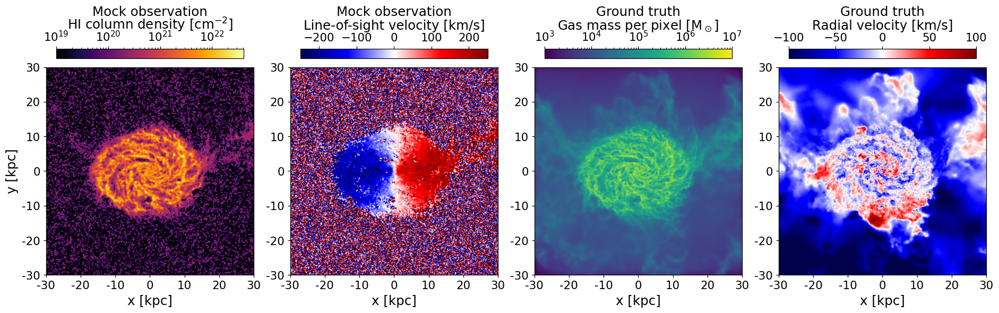
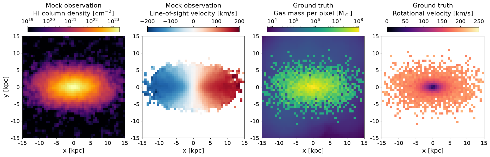

# VeryObservableFIRE

[](https://github.com/ctrapped/VeryObservableFIRE/actions/workflows/ci.yml)

**Turn galaxy simulations into realistic telescope observations, paired with true physical properties at every pixel.**


*Output of the VOF pipeline on a full-resolution FIRE-2 snapshot (m12m). Left: what a radio telescope would see (HI 21cm intensity and line-of-sight velocity), with realistic resolution and noise. Right: the true gas mass and radial velocity (blue = inflow, red = outflow) behind that image, which can be used as labels for training a neural network.*

## Details

**V**ery**O**bservable**F**IRE (VOF) bridges simulation and observation. It observes a simulated galaxy the way a real instrument would, from a variety of viewing angles, and records the ground truth for several physical properties at each pixel. The result is a labeled dataset for training neural networks (such as [CoNNGaFit](https://github.com/ctrapped/CoNNGaFit)) or validating models that infer gas flows from real telescope data.

## Highlights

- **Physics:** places the galaxy at a chosen distance, inclination, and position angle, then computes Doppler-shifted, thermally broadened emission and absorption along each sightline, convolves with the instrument beam, and adds noise.
- **Training labels:** projects the true gas mass, radial velocity, and rotational velocity onto the same pixels as the mock observation, for use training neural networks or validating model fits.
- **Performance:** a fast optically thin mode (recommended) deposits particles onto the image grid, grouping them by kernel size and choosing per group between sparse-matrix stamping and FFT convolution. This takes 30 seconds to generate and write a 512×512×128 HI 21cm datacube at a single viewing angle for a full-resolution FIRE-2 snapshot (~3,000,000 gas particles in the region of interest). The time to load, center, and process the snapshot is about 400 seconds, and is done once for multiple viewing angles. For 56 viewing angles of a single galaxy, this takes ~35 minutes, or ~2,300 images per day on a laptop (Apple M4 Max - 128 GB RAM, 16 core, single threaded).
- **Development:** an installable Python package with command-line tools, plain-text config files with command-line overrides, and logging. 80+ automated tests run on a synthetic galaxy in the FIRE file format, including end-to-end checks against stored reference outputs. Continuous integration (GitHub Actions) runs linting ([ruff](https://docs.astral.sh/ruff/), via pre-commit) and the tests on Python 3.10–3.14.

## Why

Understanding how galaxies get their gas is vital to understanding how they grow, evolve, and form stars. Figuring out how this gas reaches star-forming regions is difficult. Theory and simulations, such as [FIRE](https://fire.northwestern.edu/), predict that much of this gas at late times must transport through the gaseous disk, but observing this radial movement is not trivial. Telescopes see each galaxy from a single angle and a single point in time, blurred by finite resolution and buried in noise. The signals from this radial transport can be highly degenerate with other velocity components of the gas, making model fitting a long-standing challenge.

## Quick start

No simulation data needed:

```bash
git clone https://github.com/ctrapped/VeryObservableFIRE.git
cd VeryObservableFIRE
pip install -e .
python examples/demo.py      # writes examples/demo_output/demo.png
```


*Output of [`examples/demo.py`](examples/demo.py) on a small synthetic galaxy. Left: what a radio telescope would see (HI 21cm intensity and line-of-sight velocity). Right: the true gas properties of the demo galaxy.*

The demo writes a small synthetic disk galaxy in the same file format as a FIRE snapshot, runs the `vof` command on it, and plots the figure above.

## Installation

Requires Python 3.10+. From the repository root:

```bash
pip install -e .            # core pipeline
pip install -e ".[fits]"    # + FITS export and data augmentation (astropy, unyt)
pip install -e ".[dev]"     # + development tools (ruff, pytest, pre-commit)
```

This installs the `vof` package and three commands: `vof`, `vof-to-fits`, and `vof-augment`. The `-e` (editable) install links to this folder rather than copying it, so code changes and `git pull`s take effect without reinstalling.

## Usage

### Parameter files

The main way to run VOF is to write a parameter file and pass its path on the command line. Copy `configs/param_template.param` to a new file. It's a list of `key = value` lines, grouped under `# File Parameters` / `# Observer Parameters` / `# Run Parameters` comments. See the file itself for the full list and what each key does.

A value can reference an **earlier** key in the same file:
- as a Python expression, e.g. `noiseAmplitude = 4e19/3.` (`pi`/`arcsec` are always available in expressions too)
- as a `{key}` placeholder inside a path string, e.g. `fileDir = /path/to/sims/{galName}/snapdir_`

Otherwise, values are parsed as Python literals where possible (numbers, `True`/`False`, `None`, `[1, 2, 3]` lists) and as plain strings when not.

Edit the values, then run:

```bash
vof param_myrun.param          # or: python -m vof param_myrun.param
```

### Command-line overrides

Optional flags override values from the parameter file:

```bash
vof <param_file> [--galName NAME] [--minSnap N] [--maxSnap N] [--inclination DEG] [-v | -q]
```

- `--galName` overrides `galName`, including in any `{galName}` path templating elsewhere in the file.
- `--minSnap` overrides the starting snapshot number.
- `--maxSnap` overrides the ending snapshot number. If omitted it defaults to `--minSnap`, i.e. a single snapshot.
- `--inclination` restricts the run to this one inclination instead of the `inclinations` list in the file.
- `-v`/`--verbose` shows debug messages (per-step details, timings, intermediate values); `-q`/`--quiet` shows only warnings and errors. By default, progress is logged at the INFO level with timestamps, about one line per image. `vof-to-fits` and `vof-augment` accept the same two flags.

## Parameters

<details>
<summary>Every key a <code>.param</code> file can set (click to expand)</summary>

Grouped the same way as in `configs/param_template.param`:

### File Parameters

| Parameter | Description |
|---|---|
| `galName` | Simulation name, as a string |
| `minSnap` | Starting snapshot number |
| `maxSnap` | Ending snapshot number |
| `snapStep` | Step between snapshots to run |
| `fileDir` | Path to the directory with snapshots (should end without the trailing snapshot number) |
| `statsDir` | Path to a directory to store centering/orientation stats; created automatically if it doesn't exist |
| `output` | Directory to write outputs to |

### Observer Parameters

| Parameter | Description |
|---|---|
| `observerDistance` | Distance to the observer, in kpc |
| `observerVelocity` | Observer velocity, `[vx, vy, vz]` |
| `maxRadius` | Max radius from the disk center to image, in kpc |
| `maxHeight` | Max height above the disk plane to include, in kpc |
| `targetBeamSize` | Beam size of the instrument being modeled, in arcseconds |
| `Nsightlines1d` | Number of sightlines/pixels along one axis of the image |
| `phiObs` | Offset the image by this angle, in radians |
| `inclinations` | List of inclinations to image, in degrees |
| `position_angles` | List of position angles to image, in degrees |
| `speciesToRun` | Which line to model; currently `HI_21cm` |
| `res_km_s` | Spectral resolution, in km/s |
| `Nchannels` | Number of spectral channels (bandwidth = `Nchannels * res_km_s`) |
| `noiseAmplitude` | Noise amplitude added to the image |

### Run Parameters

| Parameter | Description |
|---|---|
| `runBinfire` | `True` to generate Binfire annotation files (mass flux, mass, rotation curve) |
| `runVOF` | `True` to generate the synthetic spectral datacubes |
| `savePng` | `True` to also save PNG previews of the images/annotations |
| `onlySaveFirstPng` | `True` to only save PNG previews for the first orientation of each snapshot |
| `createMaskFromExistingStatsDir` | `True` to mask the previously run galaxy, to find satellites/other galaxies in the snapshot |
| `num_cores` | Number of cores to use for parallel sightline generation; `None` to use all available |
| `projectGasProperties` | `True` to project the true gas mass/radial/rotational velocity directly in the same imaging pass (used together with `runAsOpticallyThinProjection`) |
| `runAsOpticallyThinProjection` | `True` for the fast optically thin column-density projection (`deposit_particles`); `False` for full per-sightline spectral synthesis |

</details>

## Repository layout

```
configs/
  param_template.param        Starting point for a run's parameter file
  examples/                   Parameter files from real runs
examples/
  demo.py                     Runs VOF on a synthetic galaxy and plots the result (no data needed)
tests/                        pytest suite; synthetic_galaxy.py writes the test galaxy, data/ holds reference outputs
vof/
  very_observable_fire.py       `vof` entry point: loads the config, derives observation parameters, loops over snapshots
  load_param_file.py            Parser for the plain-text .param format
  make_dataset.py               Per-snapshot driver: loads gas, loops over viewing angles to make images/annotation data
  orient_galaxy.py              Centering and rotating the galaxy into the observer's frame
  generate_synthetic_image.py   Builds one mock observation and writes HDF5/PNG outputs
  project_image.py              Image formation: optically thin particle deposition (sparse stamping + FFT convolution)
                                or full per-sightline spectral synthesis (parallel via joblib), then beam smoothing + noise
  calc_sightline_spectrum.py,
  generate_spectra.py           Emission/absorption spectrum along a sightline
  emission_species.py           Line parameters (HI 21cm, H-alpha, Na I D1/D2)
  calc_rotation_curve.py        Rotation curve, for observers placed inside the galaxy
  write_annotations.py          Writes Binfire annotation files and previews
  convert_to_fits.py            `vof-to-fits`: HDF5 datacube -> FITS cube
  data_augmentation.py          `vof-augment`: rotation/flip augmentation, optional SoFiA-2 denoising
  run_sofia_for_vof.sh          Wrapper used by augmentation to run SoFiA-2
  io/                           FIRE snapshot readers and loaders (load_data.py, readsnap_vof.py)
  binfire/                      Binfire: centering (shrinking sphere), disk orientation, and binned
                                ground-truth maps (mass, radial/azimuthal mass flux, rotation)
  energy_levels/                NIST Na I energy levels
```

## How it works

1. **`vof.very_observable_fire`** loads a parameter file (`vof.load_param_file.load_params`), computes derived observation quantities (beam size, line frequency, bandwidth), and calls `vof.make_dataset.make_dataset` for each snapshot in the requested range.
2. **`vof.make_dataset.make_dataset`** loads the gas particles. If `runBinfire`/`projectGasProperties` is set, it runs Binfire, which also centers the galaxy and writes the stats file the first time a snapshot is processed. It then loops over every inclination x position angle pair, rotates the galaxy into the observer's frame (`vof.orient_galaxy`), and calls `vof.generate_synthetic_image.generate_synthetic_image`.
3. **`vof.project_image.project_image`** forms the image cube, either with the fast optically thin projection (`deposit_particles`) or with full per-sightline spectral synthesis (`vof.calc_sightline_spectrum` -> `vof.generate_spectra`, using line parameters from `vof.emission_species`). The cube is then smoothed to the target beam size and has noise added.
4. The output is written as HDF5 (`*_fullSpectra.hdf5`). It holds the `spectra` and `ideal_image` datasets, plus the projected `*_annotation` maps when `projectGasProperties` is set. The `fov_kpc`/`observer_distance_kpc`/`beam_arcsec`/`dnu_kmps` attributes record the observation setup used. Zeroth/first-moment PNG previews are optional.


## Running without installing

```bash
cd /path/to/VeryObservableFIRE
python -m vof param_myrun.param
```
